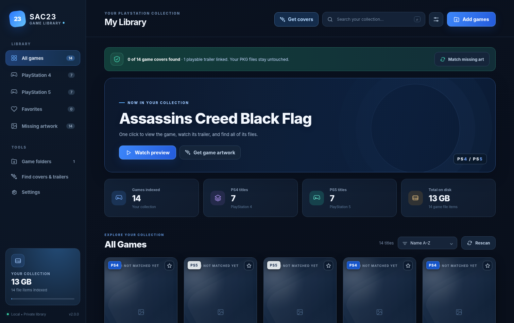
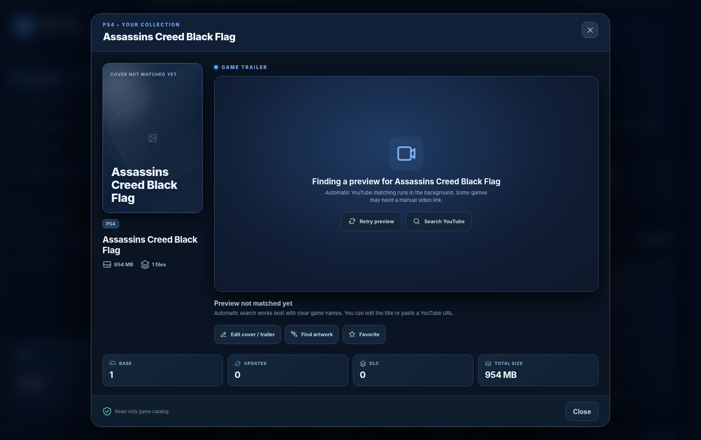

# SAC23 Game Library 🎮

**A visual PS4 and PS5 collection manager for Windows.** Browse the games you already have using cover-art cards, open a one-click details panel with a YouTube preview, and organize base games with updates and DLC. The app **does not modify your original game files**.

**Version:** 2.4.0 · **License:** MIT (source code only) · **Requires:** Windows 10/11 and Python 3.10+



*Screenshot of the demo interface before artwork is downloaded. Covers populate when matching succeeds.*

## What it does

- **Visual gallery:** filters, favorites, sorting, search, PS4/PS5 views, and storage totals.
- **Artwork:** finds covers through metadata services; caches valid downloads locally; can extract icons from supported PS4 PKGs and covers from ZIP archives.
- **One-click previews:** opens game details with an embedded YouTube trailer when a matching, embeddable video is available.
- **Multi-folder scanner:** scans selected folders on local, external, or network drives for `.pkg`, `.rar`, `.zip`, `.iso`, `.7z` and related files.
- **Grouping:** uses filenames and metadata to group games, updates and DLC where possible.
- **Cover Rescue:** can reuse artwork by a matching PlayStation title ID; offers a Cover Inbox and a missing-covers report.
- **Local-first:** runs as a browser UI served only on `127.0.0.1`. No cloud account required.



## Quick start (Windows)

1. Get `SAC23_Game_Library_v2.4.0_Windows.zip` from [GitHub Releases](../../releases) (after the first release has been published).
2. Install [Python 3.10 or newer](https://www.python.org/downloads/windows/). Make sure `py` or `python` works from Command Prompt.
3. Extract **all** ZIP contents into a folder.
4. Double-click **`Start_SAC23_Game_Library.bat`** and keep its command window open.
5. In the browser click **Add games**, select your own PS4 and PS5 folders, and choose **Get covers** or **Find missing covers**.
6. Click a game card to view its details and preview video (when available).

No additional Python packages are required; the backend uses the standard library.

### Optional keys and missing covers

Public metadata sources may work without an API key. You can optionally configure **SteamGridDB**, **RAWG** and **YouTube Data API** keys in Settings for more options. Network blocking, missing catalog entries, provider limits and inaccurate filenames can prevent an automatic match. **No artwork service guarantees 100% coverage.**

If a game lacks artwork, put a genuine JPG/PNG/WebP cover named after the game or `CUSA...` / `PPSA...` ID into the **Cover Inbox** and run **Find missing covers**. You can also choose a local image or paste a trailer URL manually.

## Run and test from source

```powershell
python game_library.py
python -m unittest discover -s tests -v
```

## Local storage and privacy

The app saves library paths, favorites, cover cache and optional API keys locally in:

```text
%LOCALAPPDATA%\SAC23_Game_Library\
```

Those personal files are **not part of this repository or the release ZIP**. API keys are stored **without encryption** inside local JSON settings, so never publish your `library.json`, cover reports, or exports without checking their contents. Cover reports omit full paths but may include recognizable package filenames. Metadata services may receive searched game titles and network information when you request artwork.

Game archives are opened **read-only**; this is not an emulator, installer, game downloader, patcher or DRM circumvention tool. The browser server is accessible only on the user's machine.

## Troubleshooting

**Blank artwork:** Confirm internet access, press **Find missing covers**, and view **Cover Report**. Third-party services can reject requests; supported PKG icons and Cover Inbox still work offline.

**No YouTube trailer:** The automatic search can fail or the owner may block embedding. Set the optional YouTube API key or paste a video URL manually.

**Nothing opens:** Check that Python is on your PATH, extract the whole ZIP, and keep the launcher's command window open.

**Network drive not found:** Mount the drive in Windows under the same user account before adding the folder.

## Contributing and releases

See [CONTRIBUTING.md](CONTRIBUTING.md) to report bugs or contribute; see [PUBLISHING.md](PUBLISHING.md) for owner publishing instructions. Automated tests run on GitHub Actions.

## Legal notice

SAC23 Game Library is independent and **not affiliated with or endorsed by Sony Interactive Entertainment, PlayStation, Valve, Google, YouTube, or any game publisher**. All game covers, trailers and trademarks remain the property of their respective owners. This repository does not bundle games, PKGs, copyrighted game artwork, trailers, or personal metadata. The **MIT license applies only to the original app code**, not third-party game/media content. Use artwork services in accordance with applicable terms.
